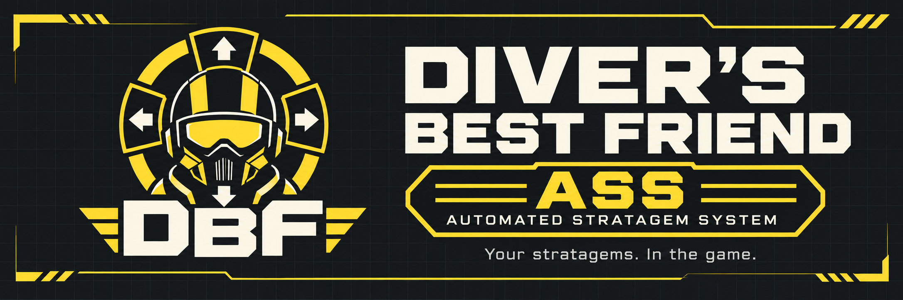

# DBF Reforged

**R50 for HellForge · revision .11**

DBF Reforged brings Diver’s Best Friend’s stratagem selection, cooldown displays and weapon strip to HellForge. Choose stratagems with the native wheel, expanded wedges or list, enter their codes automatically, then throw the beacon. The game draws the HUD, while the settings menu follows HF Editor’s typography and layout.

[Download R50 .11](https://github.com/HWG90/DiversBestFriend/releases/tag/r50-hellforge.11) · [Ayaka](https://ayakamods.com/mods/dbf-reforged-automated-stratagem-system-ass.5899/) · [Nexus Mods](https://www.nexusmods.com/helldivers2/mods/17564)

## Features

- Native wheel, wedge and list selection, with mouse, keyboard and controller bindings.
- Cooldown icons, timers, charges and adjustable dock layouts.
- A native weapon strip showing the equipped weapon’s available settings.
- Optional terminal completion, with arrow entry as the default for new configurations.
- Searchable settings, configurable shortcuts and stratagem exclusions.
- Optional MCM integration using the same saved preferences.

## Install

1. Close the game and import **divers-best-friend-R50-hellforge.11.zip** into HellForge. Keep the ZIP intact.
2. Enable **DBF Reforged** and launch the game.
3. Press **F7** to open settings.

The ZIP includes NEST 0.8.2, which starts automatically. DBF runs its HUD directly. This release targets HellForge 0.4 and Helldivers 2 game build **25480438**.

When upgrading from an earlier bundle, disable the older standalone NEST 0.8.1 entry and restart. DBF will use the included runtime. An active compatible NEST 0.8.2 installation is shared automatically. [Installation and upgrade guide](hellforge/NEST-BUNDLE.md)

## Controls

| Control | Action |
| --- | --- |
| F7 | Open DBF settings |
| Page Down | Open NEST’s panel list |
| Ctrl+F | Search settings |
| Ctrl+E | Review pending changes |
| F9 | Apply settings changes |
| Wheel Down / Wheel Up | Next / previous stratagem with default bindings |
| Left mouse button | Confirm with the default binding |

Set bindings and exclusions from the DBF menu. Select on Release uses a Hold binding for the game’s stratagem menu. Slot shortcuts begin unbound.

## NEST and other mods

NEST means **Native Extension and Settings Toolkit**. It provides the shared settings panels, hotkeys, input handling and game-thread callbacks used by DBF. Future HellForge mods can register panels with the same running framework. NEST is included so DBF’s settings work after one import.

Bingus Shared Loader can stay enabled for other addons. DBF imposes no BSL version check. MCM is optional; when installed, its DBF controls share the same preferences as the F7 menu. DBF stores preferences in `%LOCALAPPDATA%\DBF\HellForge\settings.ini`.

## Credits

Created by **HWG90 / David**, with AI-assisted development. CowboyBingus’s loader, bindings and options infrastructure provided the foundation for the original DBF. Arrowhead created the game and its native HUD assets. NEST reads the Editor font faces from the player’s installed game.

[Full credits](CREDITS.md) · [License](LICENSE) · [Changelog](CHANGELOG.md)
